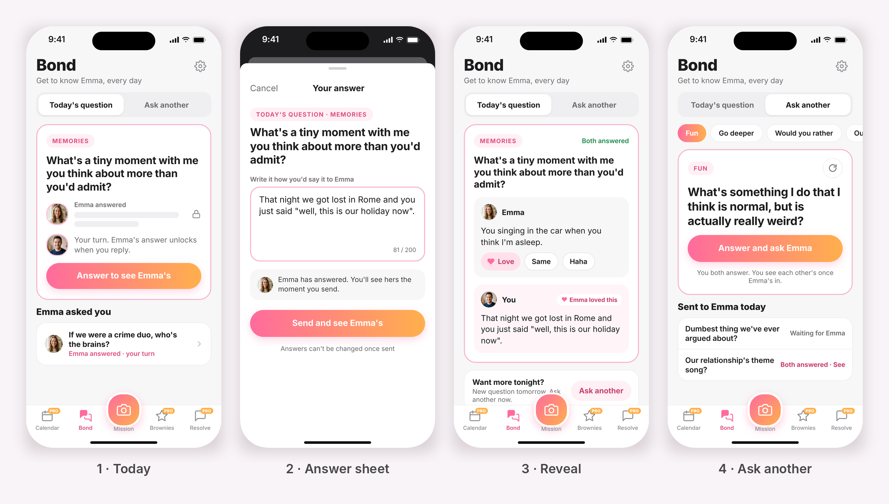

# Bond: Feature Spec (free page)

Bond is a free page where partners answer the same question in text and see each other's answers together once both have answered. There is no chat. The fun comes from good questions and quick reactions (Love, Same, Haha). Bond is free for everyone, alongside Mission, because the rest of the app is Pro.

The whole feature is one loop: ask, answer privately, reveal together, react.

**Cut from v1:** chat, answer history, double-choice taps, answer matching, a Sunday game, a Spicy category.

## 1. Where it lives

Bond takes the slot Settings used to hold. Tab bar, left to right: Calendar (Pro), Bond (free), Mission (free, centre, raised camera button), Brownies (Pro), Resolve (Pro). Settings moves to a gear icon at the top right of every screen. Pro tabs keep the pink lock badge.

Header: "Bond", subtitle "Get to know [partner name], every day".

## 2. The four screens

Design: the "CoupleIn Free Page Options" canvas, boards 1 to 4.

| Screen | What it shows | Main action |
| --- | --- | --- |
| 1. Today | Segmented control ("Today's question" / "Ask another"). Pink-bordered card with a category chip, the question, and the partner's answer blurred and locked. Below it, an "[Partner] asked you" row for questions the partner sent. | "Answer to see [Partner]'s" |
| 2. Answer sheet | Bottom sheet "Your answer" with the question, a text box (200 characters, live counter) and a note that the partner has answered. | "Send and see [Partner]'s" |
| 3. Reveal | Partner's answer and yours with reaction chips Love, Same, Haha. A "Both answered" label. An "Ask another" card at the bottom. | Tap a reaction |
| 4. Ask another | Chips: Fun, Go deeper, Would you rather, Our future, Memories. A card with one question from the chosen chip and a refresh icon. Below it, "Sent to [Partner] today" with each question's state (Waiting, Both answered). | "Answer and ask [Partner]" |

- **Today.** One daily question, the same for both partners, day-agnostic (no weekly schedule). Changes at 3AM in the couple's shared timezone, the same reset as the Mission pose (to confirm).
- **Answer sheet.** Text only, 200 characters, no empty answers. Final once sent. Placeholder: "Write it how you'd say it to [Partner]".
- **Ask another.** Pick a chip, see a question, tap refresh for the next unseen one in that chip, send it by answering it. The partner gets it in their "[Partner] asked you" row. Cap: 3 open sent questions per couple at a time (to confirm).

## 3. Rules

- **Reveal is mutual.** Neither partner sees the other's answer until they have sent their own.
- **Answers.** Typed text only, 200 characters, final once sent. Would-you-rather questions are worded so the answer is a typed sentence ("Would you rather we X or Y, and why?").
- **Reactions.** Love, Same, Haha. One per answer per person, changeable. The partner sees a badge ("[Partner] loved this").
- **Starting.** A user can use Bond once they have sent their first Mission selfie and finished onboarding. The partner does not need to be linked yet.
- **Partner not joined.** The user can answer today's question. The reveal stays locked until the partner joins and answers. This state is not drawn yet.
- **History.** None in v1.
- **Free.** No limits.

## 4. Question bank

Questions come from a large pre-written bank held on the server (MongoDB). No AI calls at runtime, so it costs nothing to run. The bank is being written in daily batches of 100 (20 per category) in the doc "CoupleIn Bond: Question Bank", Oct 12 to Oct 21.

| Category | Style |
| --- | --- |
| Fun | Playful, specific, makes people laugh |
| Go deeper | Honest but safe, never accusatory |
| Would you rather | Phrased so the answer is typed, with a "why" |
| Our future | Concrete shared scenes, not abstract goals |
| Memories | Specific moments with the partner |

The daily question can come from any category. "Ask another" serves from the chosen chip.

- **Never repeating.** Each couple stores only the IDs of questions already seen (about 20 to 30 KB at 5,000 questions). Serving picks the next unseen question. Refresh skips to the next unseen one in the chip.
- **Size.** 5,000 questions is about 400 to 500 KB of text. The app fetches about 20 per category at a time and caches them on the phone, so new questions need no app update.
- **Running out.** At about 3 questions a day, 3,000 questions last about 2.7 years. After that the oldest return as "Revisit: you answered this a year ago. Has your answer changed?".
- **Later options.** Couples write their own questions. AI-generated questions on demand, saved to the bank (running cost, so not in v1).
- **Question rules.** Typed answer, gender-neutral, any relationship stage and long-distance, no sexual content, under about 18 words, no generic questions.

## 5. Notifications

| Trigger | Push |
| --- | --- |
| New daily question (suggested 7pm local) | "Today's question is here" |
| Partner answered, user has not | "[Partner] answered. Your turn." |
| Both answered | "Both answered. See each other's." |
| Partner sent an "Ask another" question | "[Partner] asked you something" |
| Partner reacted to the user's answer | "[Partner] loved your answer" (or Same, Haha) |

## 6. Data (per couple)

- Question bank: id, text, category, active flag.
- Seen IDs: question IDs already served to this couple.
- Daily question: date, question id.
- Answers: question id, user id, text (max 200), sent time.
- Reactions: answer id, user id, type (love, same, haha).
- Sent questions: question id, sender, state (waiting, both answered).

## 7. Edge cases

| Case | Behaviour |
| --- | --- |
| Partner never answers | User's answer stays sent, reveal stays locked, no expiry in v1 |
| Both answer at the same moment | Both go straight to Reveal |
| Different timezones | Daily question changes at 3AM in the shared timezone |
| Bank exhausted for a chip | Oldest questions return as "Revisit" |
| Offline | Answer saved on the phone and sent when back online |
| Partner unlinked | Open questions and answers are removed with the link |
| Empty or over 200 characters | Send button disabled |

## 8. Open items to confirm

1. Cap of 3 open "Ask another" questions per couple.
2. Daily question notification time (suggested 7pm local).
3. The "partner has not joined" state is not drawn: what the locked reveal should say.
4. Whether the daily question resets at 3AM like the Mission pose, or at midnight.
5. Offline behaviour and what happens to open questions on unlink.
6. Answers must be stored on the server for the reveal: for how long, given photos stay on the phone.
