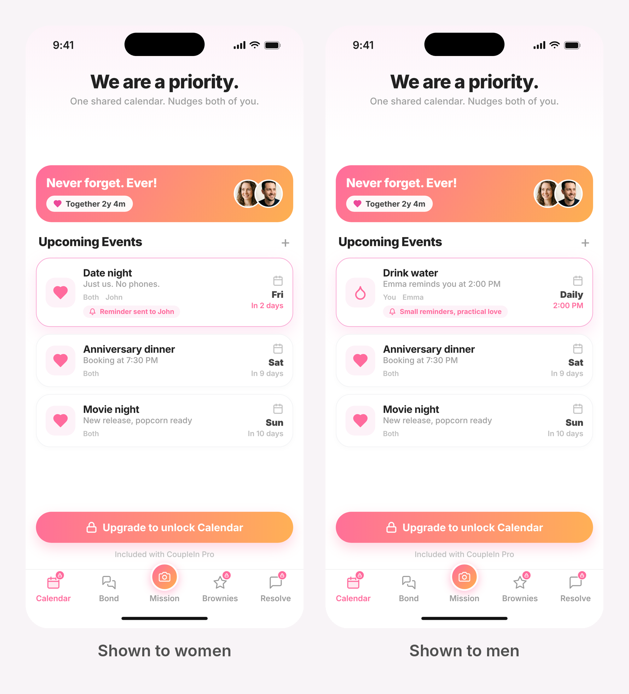
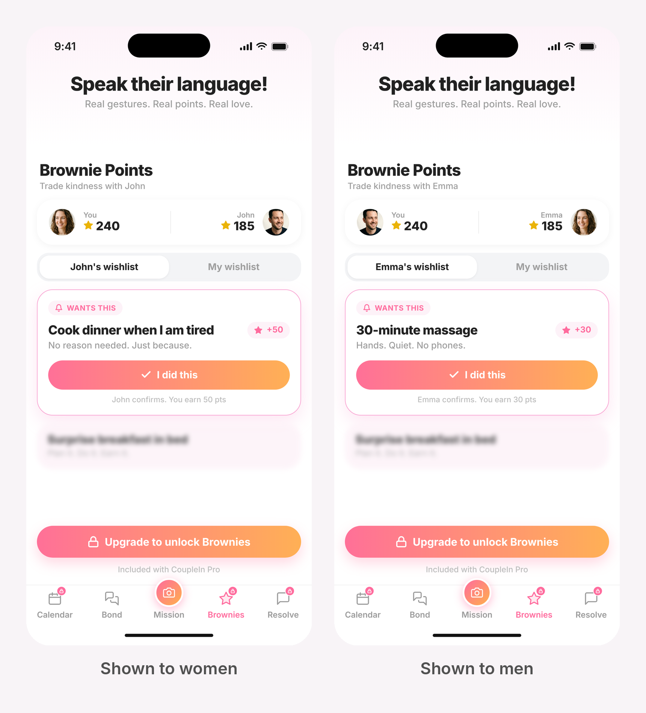
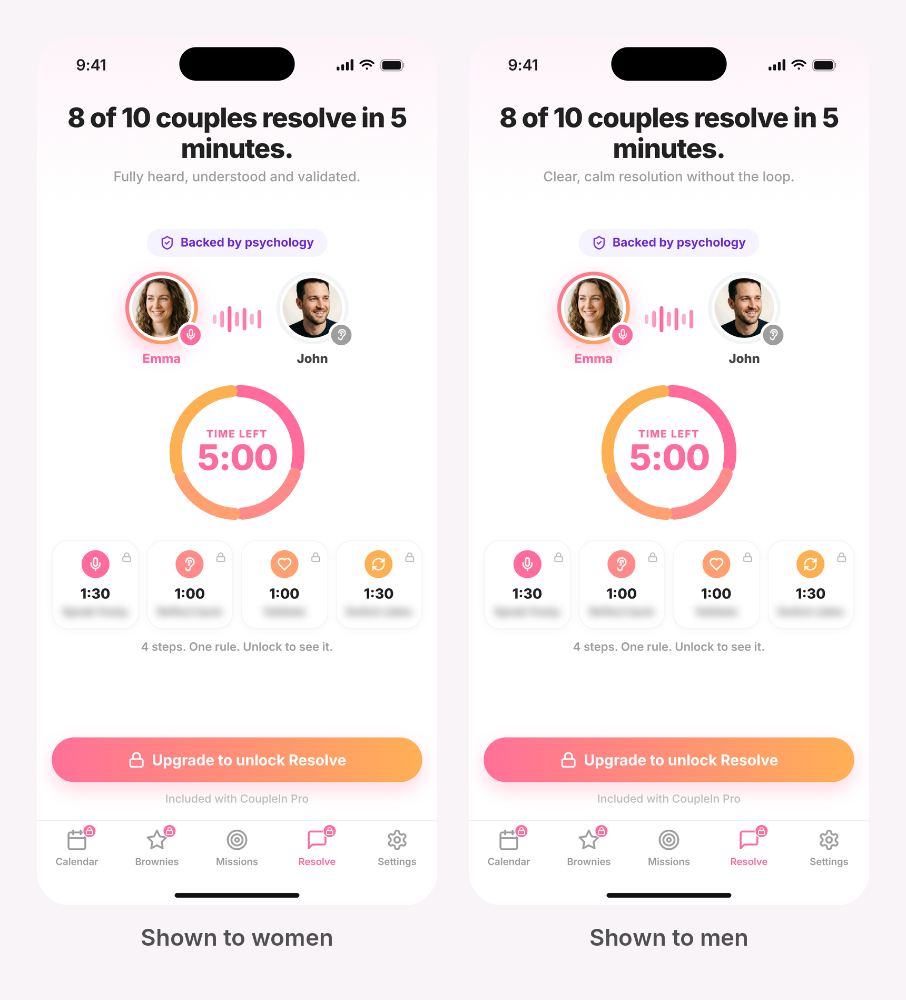
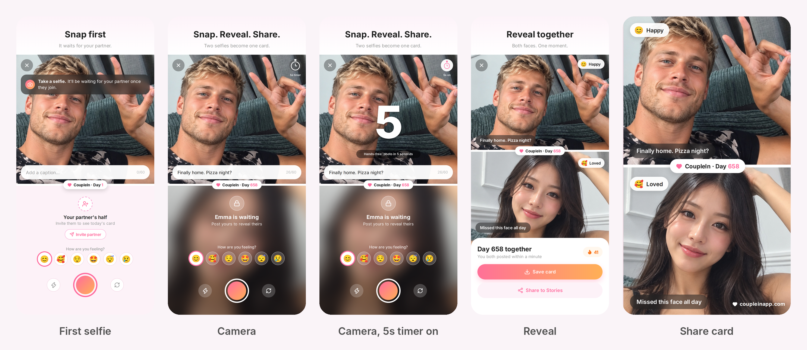

# Final Plan: Developer Spec (Sync MVP)

Oct 10, 2026

## 1. Scope

Sync is the MVP: one pose a day, both partners send a selfie, a 3-2-1 reveal shows both, and the card can be saved or posted. Everything else in the app is Pro and shown as a locked placeholder.

**In the MVP**

- One pose a day, the same pose for both partners, starting at Pose 1 (a list of 365).
- Onboarding with an invite fork, a safety promise before the first selfie, and a hard gate: no other screen until the first selfie is sent.
- Mutual lock and a 3-second "Reveal" countdown before every reveal.
- Save card and "Who did it better?" (opens the share sheet).
- A Week 1 video generated on the phone after the 7th completed pair.
- Photos stored on the phone, last 14 days viewable on Free, with a short-lived server relay to deliver photos between phones.
- Gated placeholder pages for Calendar, Brownies and Resolve, and a redesigned pricing page.

**Cut from the MVP (do not build)**

- Saturday global challenge or any second daily card.
- History grid, streaks, streak passes, missed-day tiles, mood-only posts, mood emoji on selfies.
- "Who did it better" voting and scoreboard.
- Cloud photo storage beyond the relay.

Terms: **Relationship Day Count** is days since the start date entered by the first downloader (shown as "Day 256 together"). **Pose number** counts completed poses and is independent of the Day Count. The app says "send", never "post".

## 2. Navigation, Free vs Pro, pricing and placeholders

Sync replaces Mood Sync as the centre of the app and is the only free feature, with no limit on daily use (the habit is the product). The only thing gated is viewing old photos: Free can open the last 14 days; anything older is Pro. The app opens on the camera, or on today's card if today's selfie is already sent.

**Tab bar:** Calendar, Brownies, Missions, Resolve, Settings. Only Missions is free. **Assumption:** Missions holds Sync (today's pose, camera, reveal). Confirm before building.

| Area | Free | Pro |
| --- | --- | --- |
| Sync: daily pose, send, reveal, share card | Yes | Yes |
| Past cards | Last 14 days | All, from the phone's storage |
| Calendar, Brownies, Resolve | Locked placeholder | Yes |
| Watermark on cards and Week 1 video | Yes | Removed |

**Pricing**

| Plan | Price |
| --- | --- |
| Weekly | £5.99 |
| Monthly | £9.99 |
| Yearly | £49.99 |

Redesign the pricing page to show all three plans, with Yearly highlighted. **Open:** whether Pro is per person or per couple (recommended: per couple).

**Gender at sign-up.** Asked on the name step, only to choose which placeholder is shown on the locked tabs. Options: Woman, Man, Prefer not to say (neutral version, shows either). The field is optional.

**Locked placeholders.** Each locked tab shows one demonstration page in the app's existing style, with a lock badge on the tab and a button "Upgrade to unlock [tab]". Left image is the women's version, right is the men's version.

| Tab | Promise line | What it shows |
| --- | --- | --- |
| Calendar | We are a priority. | The Calendar screen with one reminder highlighted (date night for women, drink water at 2PM for men) |
| Brownies | Speak their language! | The Brownies screen with one wishlist item highlighted (cook dinner when I am tired for women, 30-minute massage for men) and its "I did this" button |
| Resolve | 8 of 10 couples resolve in 5 minutes. | A teaser only: who is speaking and listening, a timed 5-minute ring in four turns, four locked steps showing timings only with blurred names, and a "Backed by psychology" badge. Do not reveal the method on this screen. |

The figure on the Resolve promise is a placeholder and is not verified. Replace it when real data exists.

## 3. Daily pose rules

One thing a day, every day. Each couple walks a fixed list of 365 poses in order, starting at Pose 1, at their own speed. The list has no calendar dates, so nothing refers to months, holidays or seasons.

1. A couple has one current pose number. Both partners always get the same pose.
2. A new pose unlocks at 3AM in the couple's shared timezone, but only after both partners have sent the current one.
3. If a day is missed, the couple stays on that pose. Nothing expires and nothing is lost.
4. The Relationship Day Count keeps advancing every day and is independent of the pose number.
5. Neither partner can see the other's photo until both have sent (mutual lock).
6. Every photo sent earns 25 points, whether or not the partner has sent.
7. There is no second daily card and no weekly special task in the MVP.

**Pose list.** The rebuilt list is Final-Plan-Pose-List.xlsx (Pose 1 to 365, no Month column). Pose 1 is "Lie flat on your back. Take a selfie from the ground." Every pose is free to do, every day, for as long as the couple wants: nothing about doing the daily pose is ever locked. Only viewing old photos is Pro (section 6). The first 7 poses feed the Week 1 video. In-app poses must be safe to do at home: no roads, roofs, edges or water.

## 4. Onboarding

The promise made before any photo is taken: neither partner can see the other's selfie until both have sent. The app says "send", never "post".

**Hard gate.** Neither partner can reach any other screen until they have sent their first selfie. There is no skip, "Not now" or "Remind me later" on the selfie. If the app is closed it reopens on the camera. The only other exit is Settings, to grant camera permission. (Whether the gate also applies to later daily poses is an open item, section 8.)

**Step 0: fork (after the opening animation and sign-in)**

"Do you have an invite code from your partner?"

- **Yes, I have a code**: Flow B. A deep link pre-fills the code and skips this screen. Invalid: "That code doesn't match anyone. Check with [Partner Name] and try again." Expired: "Ask [Partner Name] to send a new invite."
- **No, I'm starting first**: Flow A as User 1.
- **Skip, I'll enter it later**: Flow A as if User 1, with "Have a code? Enter it here" on the waiting screen. Late-connection rules in section 7 apply.

**Flow A: User 1 (first downloader)**

1. **Opening animation**, 5 seconds, two blurred faces with a lock between them: "One selfie a day. Both of you. Unlocked together."
2. **Sign in** with Apple or Google, unchanged.
3. **Name and gender.** "What should we call you?", pre-filled from the social account, skippable (falls back to the account name, then "You"). Gender options: Woman, Man, Prefer not to say. Basic banned-word filter.
4. **Partner name**, required.
5. **Relationship start date**, required. Date picker, with "I don't remember exactly" falling back to month and year (stored as the 1st). No future dates, nothing before 1970. Editable later in Settings.
6. **Safety promise**, before any camera. Two phones facing each other, a locked photo on each, an arrow "both unlock together". Copy: "Before you send your first selfie. Your selfie stays private. [Partner Name] cannot see it, and you cannot see theirs, until you have both sent. There is no way to peek. Not even we can unlock it early." Button: "Got it, let's send Pose 1". Link: "How does this work?" opens a one-line modal. Not skippable.
7. **Camera, Pose 1** (section 5). No skip.
8. **Card preview and lock.** Their selfie on the card, "Day 256 together", "Pose 1", partner's side blurred with a lock. "Your selfie is locked. [Partner Name] still can't see it. Send them an invite so they can send theirs, then both unlock at the same time." Buttons: Invite [Partner Name] / Remind me later.
9. **Compliment.** "What's one thing you love about [Partner Name]?" Free text, with three suggestions after 5 seconds of nothing. Basic banned-word filter.
10. **Share screen.** Message: "Hi [Partner Name], [Your Name] loves that you are so [compliment]. They made a selfie just for you. Send yours to unlock it." The blurred locked card is attached as an image. Buttons: Share to WhatsApp / Copy link / Remind me later.
11. **Waiting screen.** Own locked card, "Waiting for [Partner Name] to join." Send reminder. Further selfies stack as locked and unlock when the partner joins. Warning: "Your selfies live on this phone. Don't delete the app until [Partner Name] joins."
12. **Push when the partner sends:** "[Partner Name] just sent theirs. Tap to reveal."
13. **Countdown:** "Reveal" then "3... 2... 1..." (section 5), then the reveal. Buttons: Save card / Who did it better?
14. **Week 1 video promise.** "Send 7 poses and we'll make you a video of your first week."

**Flow B: User 2 (partner, arrives by invite)**

1. Invite link goes to the store listing, or opens the app, carrying the invite token. It must land on the locked card (step 4), not a bare store page.
2. Sign in.
3. Name and gender only. Partner name and start date are inherited from User 1.
4. **Locked card and safety promise.** The exact card User 1 made, their face blurred under a lock, "Day 256 together". "[Partner Name] is waiting. You will be able to see [Partner Name]'s selfie once you send yours. Your selfie stays private too." Button: Send today's selfie. No "Not now": the app stays here until they send.
5. Camera, Pose 1. No name, date or code fields.
6. Countdown, reveal, the Week 1 video promise, then the same compliment and share step as User 1 (optional), then the normal app.

## 5. Camera, reveal, share card and Week 1 video

**Camera screen.** Full screen, tab bar hidden, X at top-left (only after the first selfie is sent), front camera, saved photo not mirrored. Layout follows the "First selfie" mock below: the photo fills the top half, the white line carries a "Day N together" pill, the partner's panel (locked, or invite) sits below.

**Pose prompt.** Shown on the live camera view in the dark translucent pill (where the coach banner sits in the mock), for example "Pose 1: Lie flat on your back. Take a selfie from the ground." When the shutter is pressed the pill fades and the pose text becomes the default caption above the white line. The user can edit it (60 characters). The same prompt is in the daily notification.

**5-second timer (hands-free).** Many poses need both hands or the phone held at a distance, so the camera has a small timer button at the top-right, opposite the X (see the third mock). Off by default, labelled "5s timer". Tapping it turns it on (white button with a pink stopwatch, label "5s on"). With it on, pressing the shutter starts a 5, 4, 3, 2, 1 countdown shown large over the camera with a pill "Hands-free: photo in 5 seconds", a light tick or haptic each second, and the photo is taken automatically at zero. Pressing the shutter again or the timer button during the countdown cancels it. After the photo the flow is identical to a normal selfie (caption, send, lock). The timer choice is remembered on the device. Optional: when a pose needs distance or both hands, show "Needs both hands? Turn on the 5s timer" under the pose prompt. This is separate from the 3-second "Reveal 3, 2, 1" countdown, which only plays before the reveal.

**Camera permission denied.** Explain why and link to Settings. A gallery fallback is allowed only in this case, with a warning.

**Countdown before every reveal.** Full-screen, dark or blurred background, both photos hidden behind a combined card. The word "Reveal" then "3... 2... 1...", one second per number (3 seconds total). No skip. It runs from local state with no network dependency. The combined card is rendered and cached before the countdown starts so the reveal has no spinner. If the app is closed mid-countdown, reopening lands on the reveal. If the user taps the push hours later, the countdown still plays. The countdown never shows the phrase "Who did it better?".

**Reveal screen.** Both photos on one card, "Day 256 together", "Pose N", "You're both in." Two buttons: **Save card** (download to the phone) and **Who did it better?** (opens the share sheet with the card).

**Share card.** 1080 x 1920 (9:16) PNG. Your selfie on top, partner's below, an 18px white line between. A white pill on the line reads "Day N together" with the pose number. Caption pills on each photo, "coupleinapp.com" watermark bottom-right (removed for Pro). Built on the phone when Save or Share is tapped, never stored.

**Week 1 video.** Promised on the first reveal screen. Generated on the phone from the first 7 completed pairs (photos are local), about 10 to 15 seconds: each pair cut to a beat with its pose name and "Day N together", ending on a title card with the date range. Delivered when the 7th pair is revealed, with a push: "Your Week 1 video is ready." Free gets it with the watermark and sees "Remove the watermark" as an upgrade. If a couple is slow, send a partial video on day 10 using the pairs that exist.

**Reference screens.** These mocks predate the latest decisions. Follow the text where they differ: no mood row, no streak badge, "posted within a minute" removed, "Share to Stories" becomes "Who did it better?", the Moments history screen is dropped, and the reveal countdown screen is not drawn yet. The camera mock now includes the 5-second timer button (third screen).

## 6. Storage, relay and privacy

Photos live on each phone, not on a CoupleIn server, so permanent storage costs nothing. Free users can open the last 14 days of cards. Older photos stay on the phone but are locked behind Pro. Users can always save or download a card on the day it is made.

**The relay.** Photos can only reach the partner's phone through a temporary server relay:

1. On send, the compressed photo (about 300 KB, location data stripped) is uploaded encrypted to a temporary store, tagged with couple and pose.
2. The server releases a photo only after both partners have sent. This is what makes "not even we can unlock it early" true. Do not rely on blurring on the phone.
3. After both phones have downloaded both photos, delete the relay copy. If a phone never downloads, delete after 30 days.
4. Each phone keeps both photos locally and builds cards and videos from there. The card and video are not stored on the server.

If the partner has not joined, the sender's photos wait on the relay for up to 30 days and are visible to nobody else.

**Cost at 100,000 photos a day** (approximate, 300 KB photos; check provider prices)

| Item | Cloudflare R2 | AWS S3 |
| --- | --- | --- |
| Uploads (3 million a month) | about $13.50 | about $15 |
| Downloads (3 million a month) | about $1 | about $1 |
| Download bandwidth (about 900 GB a month) | free | about $75 |
| Storage while waiting (about 150 GB average) | about $2 | about $3.50 |
| **Total** | **about $17 a month** | **about $95 a month** |

R2 is preferred because it charges nothing for downloads.

**Locking after 14 days.** From day 15 a photo shows a locked placeholder with "Upgrade to see your photos". Warn on days 10 to 13 that photos are about to lock. Users can still save any card before it locks.

**Store and legal requirements**

- Update the App Store privacy label and Google Play data-safety form (photos and gender are now collected).
- Update the privacy policy: what goes to the relay, how long it stays, deletion for both partners when one leaves.
- Camera permission reason string on iOS.
- In-app account deletion (required by Apple).
- An "unlink partner" option in Settings.
- Report and block, because cards can be shared publicly.

## 7. Notifications, edge cases and data

**Notifications**

| When | Message |
| --- | --- |
| New pose unlocks (3AM shared timezone, delivered at the couple's chosen time) | Contains today's pose, so the task is visible before opening the app |
| Partner has sent | "[Partner Name] just sent theirs. Tap to reveal." Opens the countdown |
| Partner has not joined after 7 days | Reminder to the inviter |
| Photos about to lock (days 10 to 13) | "Save your cards before they lock" |
| 7th pair revealed | "Your Week 1 video is ready" |

**Late-connection reconciliation.** User 2 downloads without a code, goes through Flow A and sends Pose 1 alone, then later enters a valid code on the waiting screen:

1. The code matches User 1's pending invite. The couple's start date is User 1's own; User 2's own date is overwritten.
2. User 2's photo is kept as their Pose 1. They are not asked to retake it.
3. Both Pose 1 photos are paired immediately and go to the countdown, then the reveal. No backlog.
4. The normal daily cadence resumes at the next 3AM.

**Edge cases**

| Situation | Behaviour |
| --- | --- |
| Permission denied | Explain, link to Settings, gallery fallback with warning |
| User 1 closes app before inviting | Next open returns to the card preview and lock screen; selfie is saved |
| User 2 installs but closes before selfie | Next open returns to the locked card and safety promise |
| Upload fails | Retry prompt; the photo stays on the phone and is never lost |
| Signed in as someone else on an invite link | "This invite is for [Partner Name]. Sign in with the right account?" |
| Different timezones | Shared timezone defaults to the inviter's, editable in Settings; pose resets at 3AM there |
| Start date changed | Editable in Settings, Day Count recalculates |
| User wants a different pose | Not allowed; everyone gets the same pose |
| App closed mid-countdown | Reopen lands on the reveal |
| User 1 deletes the app before the partner joins | Local photos are lost; warning shown on the waiting screen |

**Backend records (metadata, plus the temporary relay)**

- Couple: couple_id, user_1_id, user_2_id (empty until the partner joins), relationship_start_date, pose_number, pending_invite_token, shared_timezone, last_pose_reset, plan.
- User: user_id, display_name, gender (optional), auth_provider, partner_id, timezone, notification_enabled.
- Send record: couple_id, pose_number, sent_by, sent_at, unlocked, relay_path (cleared once both phones have downloaded).

**Analytics (PostHog):** first_selfie_sent, partner_invited, partner_joined, reveal_viewed, card_saved, who_did_it_better_tapped, week1_video_ready, paywall_viewed, plan_started.

## 8. Open items and build checklist

**To confirm with the founder before building**

1. Does the Missions tab hold Sync (today's pose, camera, reveal)? Assumed yes.
2. Is Pro per person or per couple? Recommended per couple.
3. Does the hard gate (no other screen until you have sent) apply to every daily pose, or only the first selfie? Built as first selfie only.
4. What do points buy, and is there a daily cap? Points are earned (25 a photo) but the spend is undefined.
5. Week 1 video trigger: 7 completed pairs, with a partial video on day 10 if slow. Assumed.

**Build checklist**

- Relay with release-after-both-sent enforced on the server (the core technical risk).
- 3AM shared-timezone reset.
- Push notifications: new pose, partner sent, 7-day reminder, lock warning, video ready.
- Deep links that land on the locked card, not the store page.
- On-device card and video generation. Front camera not mirrored. Test on several Android phones.
- Locked placeholders and the three-plan pricing page.
- Store forms, privacy policy, in-app account deletion, unlink partner.
- 5-second hands-free timer on the camera (top-right button, countdown, auto-capture, cancel). Test with the front and back camera and with flash.
- Load the pose list from Final-Plan-Pose-List.xlsx (Pose 1 to 365, no dates).
- Test with two accounts on two phones, one set to another timezone, covering: both send, one sends, partner never joins, late code entry, app closed mid-countdown, upload failure, 14-day lock.
